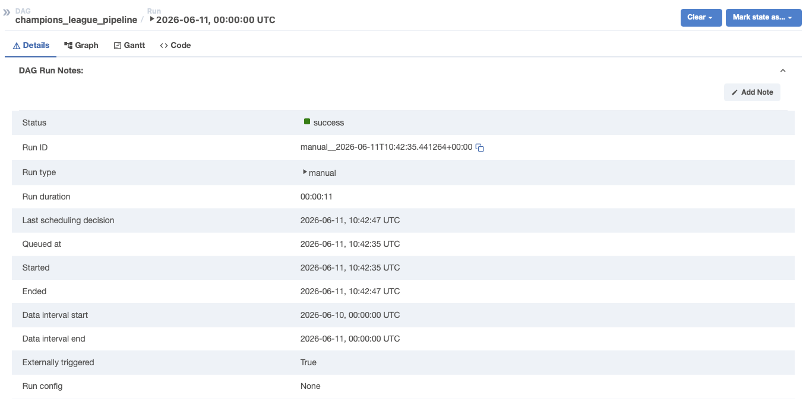

# Champions League Data Pipeline

End-to-End Cloud-Native ETL/ELT Pipeline fuer UEFA Champions League Daten mit Snowflake Star Schema, AWS S3, dbt, Great Expectations und Apache Airflow Orchestrierung.

       

## Ueber den Autor

Ich bin Antonio Prete, Quereinsteiger ins Data Engineering nach 11 Jahren Berufserfahrung als Verfahrensmechaniker in der industriellen Produktion. Dieses Projekt entstand als Portfolio Arbeit waehrend meiner autodidaktischen Weiterbildung. Es zeigt eine typische End to End Data Engineering Aufgabe mit modernem Tech Stack inklusive dbt und Great Expectations.

## Ueber das Projekt

Diese Pipeline holt UEFA Champions League Daten von der Football Data API, bereinigt sie mit Pandas und speichert sie in mehreren Storage Layern. Lokales CSV, AWS S3 Cloud Storage mit Bronze Silver Pattern und Snowflake Star Schema als Gold Layer. Mit dbt werden Transformationen in Staging und Marts Modelle aufgeteilt. Great Expectations stellt die Datenqualitaet mit automatisierten Tests sicher.

Was wird verarbeitet.

- 36 Champions League Teams
- 144 Spiele der aktuellen Saison
- Datum Dimension fuer Zeit Analysen
- Automatisierte Datenqualitaets Pruefungen auf 3 Ebenen

## Architektur

Football Data API → Python/Pandas → Multiple Storage Layers

- Lokal CSV fuer Development
- AWS S3 Bronze als Raw Daten
- AWS S3 Silver als bereinigte Daten
- Snowflake Star Schema als Gold Layer
- dbt baut Staging Views und Marts Tabellen in Snowflake
- Great Expectations prueft Datenqualitaet auf allen Ebenen

Orchestriert durch Apache Airflow mit taeglichem Schedule.

## Portfolio Version 2 Erweiterungen

Diese zweite Version der Pipeline erweitert das urspruengliche Setup um moderne Data Engineering Tools die in echten Unternehmen Standard sind.

### dbt Integration

- 3 Staging Modelle als Views in DBT_DEV Schema
- 1 Marts Tabelle fuer Team Performance Analyse mit Siegen Niederlagen und Punkten
- 13 automatisierte Tests fuer Unique Not Null Relationships und Accepted Values
- Source Definitionen fuer klare Herkunftsnachweise

### Great Expectations Data Quality

- 16 Expectations verteilt auf 3 Tabellen
- Not Null Unique Between Range und Set Validation
- HTML Data Docs als Report
- Automatische Dokumentation der Datenqualitaet
- Entdeckter Data Quality Issue mit negativen Platzhalter Werten dokumentiert

### Business Insights aus Marts

- Team Performance mit Siegen und Punkten
- Tore Statistik pro Team
- Ranking nach Fussball Regeln

## Screenshot

### Erfolgreicher Pipeline Lauf in Apache Airflow



## Tech Stack

- Python 3.12 Hauptsprache
- Pandas Datenbereinigung und Transformation
- Requests REST API Calls
- AWS S3 Cloud Object Storage mit boto3
- Snowflake Cloud Data Warehouse
- dbt Core 1.11 Transformationen und Tests
- Great Expectations 1.23 Data Quality Framework
- Apache Airflow 2.8 Workflow Orchestrierung
- Docker Compose Container Setup
- SQLAlchemy DB Connection
- python dotenv Secrets Management
- Python logging Strukturierte Logs

## Projekt Struktur

```
champions_league_pipeline/
├── src/
│ ├── extract_data.py # API Abruf
│ ├── pipeline.py # Haupt ETL Script mit S3 Upload
│ └── load_to_snowflake.py # Snowflake Loader
├── dags/
│ └── champions_league_dag.py # Airflow DAG
├── champions_league_dbt/
│ ├── models/
│ │ ├── staging/
│ │ │ ├── sources.yml
│ │ │ ├── schema.yml
│ │ │ ├── stg_team.sql
│ │ │ ├── stg_datum.sql
│ │ │ └── stg_spiel.sql
│ │ └── marts/
│ │ └── fct_team_performance.sql
│ └── dbt_project.yml
├── great_expectations_tests/
│ ├── run_expectations.py
│ └── gx/ # Great Expectations Config
├── tests/
├── data/
│ ├── bronze/
│ ├── silver/
│ └── gold/
├── .env
├── .gitignore
├── README.md
└── requirements.txt

```


## Setup Anleitung

### Voraussetzungen

- Python 3.12+
- Docker Desktop
- Snowflake Account
- AWS Account mit S3 Bucket
- Football Data API Key kostenlos auf football data org

### Installation

1. Repository klonen git clone
2. Python Pakete installieren pip install r requirements txt
3. env Datei erstellen mit allen Credentials
4. AWS S3 Bucket erstellen Region eu central 1
5. Snowflake Tabellen erstellen Star Schema
6. Pipeline starten python src pipeline py
7. dbt setup cd champions_league_dbt dann dbt debug dann dbt run dann dbt test
8. Great Expectations ausfuehren python great_expectations_tests run_expectations py
9. Mit Airflow automatisieren docker compose up d Web UI auf localhost 8080

## dbt Modelle

### Staging Layer

Drei Modelle lesen aus den Rohtabellen und produzieren saubere Views mit lowercase Spaltennamen.

### Marts Layer

Team Performance Tabelle mit folgenden Metriken pro Team.

- Anzahl gespielte Spiele
- Siege Niederlagen Unentschieden
- Tore erzielt und kassiert
- Tordifferenz
- Punkte nach Fussball Regeln

## Great Expectations Suites

### DIM TEAM Suite

- Team ID not null und unique
- Name not null
- TLA Laenge zwischen 2 und 10 Zeichen

### DIM DATUM Suite

- Datum ID not null und unique
- Datum not null
- Monat zwischen 1 und 12
- Tag zwischen 1 und 31

### FACT SPIEL Suite

- Spiel ID not null und unique
- Heim und Gast Team ID not null
- Tore zwischen minus 1 und 20
- Status in erlaubter Werte Liste

## Was ich gelernt habe

- REST APIs mit Authentifizierung und Error Handling
- Datenbereinigung mit Pandas
- Star Schema Data Modeling
- Cloud Native Architektur mit AWS S3 Medallion Pattern
- Identity Access Management mit AWS
- Snowflake Cloud Data Warehouse und RBAC
- dbt fuer modularisierte SQL Transformationen
- dbt Tests fuer strukturelle Datenqualitaet
- Great Expectations fuer semantische Datenqualitaet
- HTML Data Docs als Qualitaets Dokumentation
- Apache Airflow Orchestrierung
- Docker und Container Setup
- SQLAlchemy mit Transactions
- Secrets Management
- Production Standard Logging

## Was ich als naechstes machen wuerde

- Snowflake liest direkt aus S3 externes Stage
- Inkrementelle dbt Models statt Full Refresh
- CI CD mit GitHub Actions
- Monitoring und Alerting mit CloudWatch
- Rohdaten -1 Werte durch NULL ersetzen

## Kontakt

Antonio Prete Aspiring Data Engineer

- LinkedIn https linkedin com in antonio prete
- Email antonio_prete@icloud.com
- GitHub PreteAntonio1990
